<h3 align="center">〔 about me 〕</h3>

Hey, I'm **Eduardo Nitz**: final-semester **Systems Analysis and Development** student who likes building clean, fast and good-looking software. Lately I've been deep into AI agents and developer tools.

- 🎓 Systems Analysis and Development — last semester
- 💻 Front-end focused: React, JavaScript, TypeScript
- ⚙️ Back-end with Node.js and .NET / C#
- 🤖 Building AI-agent tooling: <b>NitzBoard</b> and <b>prettygit</b>
- 📍 Novo Hamburgo, RS — Brazil

 

<h3 align="center">〔 technologies 〕</h3>

<h3 align="center">〔 featured 〕</h3>

- **[prettygit](https://github.com/DadoNitz/prettygit)** — ✨ AI agent + skills kit: turn your GitHub profile into a polished README and a PDF resume (professional, aesthetic, direct, noir).
- **[nitzboard-releases](https://github.com/DadoNitz/nitzboard-releases)** · [live ↗](https://github.com/DadoNitz/nitzboard-releases/releases/latest) — 🧩 NitzBoard: a canvas to run AI coding agents (Claude Code, Codex, Gemini) side by side. Installers for Windows & macOS.
- **[tempo-landing](https://github.com/DadoNitz/tempo-landing)** · [live ↗](https://dadonitz.github.io/tempo-landing/) — ⏱️ Landing page for a fictional focus app with a working timer demo: draggable spring dial, React Bits motion, Apple-style feedback.
- **[velo-nove](https://github.com/DadoNitz/velo-nove)** · [live ↗](https://dadonitz.github.io/velo-nove/) — 🚲 Product landing for a fictional e-bike: pinned scroll storytelling, animated specs, spring color configurator, React Bits.
- **[ondina-arquitetura](https://github.com/DadoNitz/ondina-arquitetura)** · [live ↗](https://dadonitz.github.io/ondina-arquitetura/) — 🏛️ Institutional site for a fictional architecture studio in Porto Alegre: editorial layout, React Bits text motion, project gallery transitions.
- **[torra-alta](https://github.com/DadoNitz/torra-alta)** · [live ↗](https://dadonitz.github.io/torra-alta/) — ☕ Institutional site for a fictional specialty coffee roastery: scroll-driven roast story, 3D tilt packages, React Bits animations.
- **[nightwatch-dashboard](https://github.com/DadoNitz/nightwatch-dashboard)** — 🛰️ NIGHTWATCH: real-time system telemetry for a dedicated monitor (CPU/GPU temps, fans, disks, network) + JARVIS assistant.

<h3 align="center">〔 statistics 〕</h3>

<h3 align="center">〔 languages 〕</h3>

<code>🇧🇷 Portuguese — native</code> · <code>🇺🇸 English — advanced</code> · <code>🇪🇸 Spanish — basic</code>

<code>Technology is constantly evolving, and so am I.</code>

